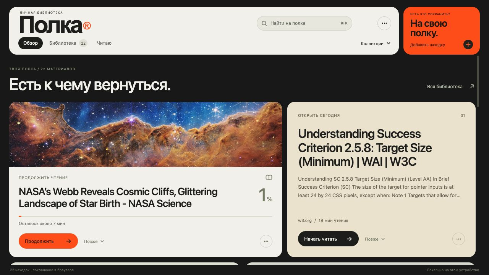

# Полка — презентация проекта

Браузерная презентация учебного проекта «Полка»: личной библиотеки статей, референсов и видео.

Первая версия от **28 октября 2026 года**. Восемь слайдов, анимированные переходы, обзор и заметки для выступления на 5–7 минут.

## Открыть

Скачайте репозиторий через **Code → Download ZIP**, распакуйте и откройте `index.html` в браузере. Установка зависимостей и доступ к интернету не нужны.

- [PDF-копия](polka-presentation.pdf)
- [Текст выступления](speaker-notes.txt)

## Управление

| Клавиша | Действие |
| --- | --- |
| ← / → или пробел | Переключение слайдов |
| O | Обзор всех слайдов |
| N | Заметки к текущему слайду |
| F | Полный экран |
| Esc | Закрыть обзор или заметки |
| Home / End | Первый / последний слайд |

На мобильном устройстве доступны кнопки и горизонтальный свайп. При включённом уменьшении движения переходы отключаются. Заметки показываются в том же окне: перед демонстрацией экрана их нужно закрыть.

## Содержание и статус

Изображения относятся к **раннему веб-прототипу**, а не к актуальным нативным приложениям. На слайдах это отмечено. Следующая редакция предполагает замену экранов.

Функции следующего этапа обозначены как планы. Презентация не заявляет подтверждённый спрос, пользовательские метрики или выручку. Этот репозиторий содержит презентацию; исходного кода приложений «Полки» здесь нет.

## Обновление

- `slides.js` — содержание слайдов и заметки докладчика.
- `style.css` — оформление.
- `app.js` — переключение, анимация и управление.
- `assets/` — изображения. Для простой замены сохраните имена файлов и пропорции.
- `polka-presentation.pdf` — статичная резервная копия; после правок её нужно обновить.
- `speaker-notes.txt` — отдельная копия заметок; обновляется вместе с текстом слайдов.

## Визуальное направление

Оформление разработано по предоставленным референсам: крупная типографика, светлые и тёмные поверхности, приглушённый зелёный и композиции со стопками карточек.

- [Референс движения](https://ru.pinterest.com/pin/880101952198818688/)
- [Studio Noteform](https://studionoteform.com/products/pitch)

Исходный шаблон Noteform не использовался. Изображения внутри интерфейса могут содержать материалы сторонних авторов; публикация презентации не передаёт права на них.
